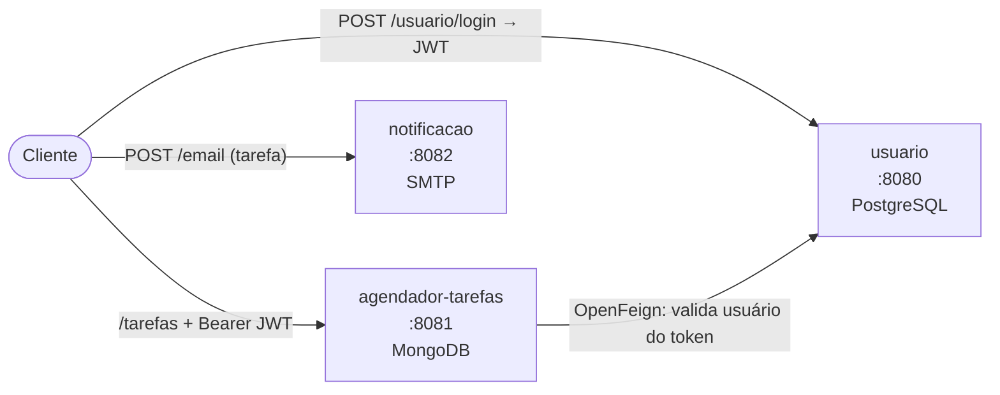

# 📧 Notificação — Microsserviço de e-mail

Microsserviço que **envia e-mails HTML** avisando o usuário sobre suas tarefas agendadas. Recebe os dados da tarefa via REST e monta a mensagem a partir de um template **Thymeleaf**.


## ✨ Funcionalidades

- Endpoint REST que recebe uma tarefa e dispara o e-mail
- E-mail em **HTML** gerado com template Thymeleaf (`templates/notificacao.html`)
- Envio via **SMTP** (Spring Mail, configurado para Gmail)
- Tratamento de falhas de envio com exceção própria (`EmailException`)
- Pipeline de **CI no GitHub Actions**

## 🧱 Stack

Java 17 · Spring Boot 4 (Web MVC, Mail, Thymeleaf) · Lombok · Gradle · GitHub Actions

## 🧩 Arquitetura do sistema

Este repositório faz parte de um **sistema de agendamento de tarefas com notificação por e-mail**, dividido em 3 microsserviços Spring Boot:

| Serviço | Porta | Banco | Responsabilidade |
|---|---|---|---|
| [usuario](https://github.com/EduardoAmorimGit/usuario) | 8080 | PostgreSQL | Cadastro de usuários, endereços e telefones; login e emissão de JWT |
| [agendador-tarefas](https://github.com/EduardoAmorimGit/agendador-tarefas) | 8081 | MongoDB | CRUD de tarefas do usuário e controle do status de notificação |
| [notificacao](https://github.com/EduardoAmorimGit/notificacao) | 8082 | — | Envio de e-mail HTML (Thymeleaf + SMTP) avisando sobre a tarefa |



1. O usuário se cadastra e faz login no serviço **usuario**, que devolve um token JWT.
2. Com o token, ele cria e gerencia tarefas no **agendador-tarefas**. O agendador lê o e-mail do token e confirma o usuário no serviço **usuario** via **OpenFeign**.
3. O serviço **notificacao** recebe os dados de uma tarefa e envia um e-mail de lembrete. Status das tarefas: `PENDENTE`, `NOTIFICADO`, `CANCELADO`.

## 🚀 Como rodar

Pré-requisitos: Java 17 e uma conta de e-mail com SMTP habilitado (no Gmail, use uma **senha de app**).

1. Preencha `spring.mail.username` e `spring.mail.password` em `src/main/resources/application.yaml` (não versione a senha).
2. Rode:

```bash
./gradlew bootRun
```

A API sobe em `http://localhost:8082`.

## 📡 Endpoint

| Método | Rota | Descrição |
|---|---|---|
| POST | `/email` | Envia o e-mail de notificação da tarefa |

```bash
curl -X POST http://localhost:8082/email -H "Content-Type: application/json" \
  -d '{"nomeTarefa":"Consulta médica","descricao":"Levar exames",
       "dataEvento":"01-12-2026 09:00:00","emailUsuario":"maria@email.com"}'
```

## 🗺️ Próximos passos

- [ ] Ler credenciais SMTP de variáveis de ambiente
- [ ] Consumir eventos por mensageria (RabbitMQ/Kafka) em vez de chamada síncrona
- [ ] Testes com GreenMail
- [ ] Docker Compose para subir os 3 serviços juntos

---

Desenvolvido por **Eduardo Amorim** · [LinkedIn](https://www.linkedin.com/in/eduardosiamorim)
